# Arquitectura

Cómo está hecho el programa: primero **todo junto** y después **pieza a pieza**, cada una con las demás
con las que se relaciona. Los diagramas se acercan y alejan con los botones de su esquina (o con doble
clic), se mueven arrastrando y se ven a pantalla completa con ⛶. Están escritos como texto en este
mismo fichero (`docs/arquitectura.md`, bloques `mermaid`), así que se ponen al día con el código.

## 1. Cómo leer los diagramas

Cada caja lleva entre corchetes **qué es**:

| Etiqueta | Qué es | Ejemplo |
|---|---|---|
| **[Núcleo de Django]** | Lo que trae Django de serie y no se puede quitar | ORM, vistas, plantillas |
| **[Contrib de Django]** | Aplicaciones opcionales que vienen con Django | `django.contrib.auth` |
| **[Librería Python]** | Paquete de Python instalado con pip (`requirements.txt`) | psycopg, Pillow |
| **[Librería JS]** | Librería de JavaScript instalada con npm (`package.json`) y servida por nosotros | htmx, FullCalendar |
| **[Servicio]** | Programa que corre aparte y al que se conecta Django | PostgreSQL, Redis |
| **[Servicio externo]** | Algo de Internet que no controlamos | teselas de OpenStreetMap |
| **[Herramienta]** | Solo para desarrollar o probar; no está en producción | Playwright, Tailwind CLI |
| **[Configuración]** | Ajustes y direcciones del proyecto (`config/`) | settings.py |
| **[Módulo · capa]** | Una app de Django nuestra, con su capa | `proyectos` · Funcional |
| **[Componente]** | Pieza común dentro de un módulo (casi siempre de `base`) | tabla filtrable |
| **[Isla JS]** | Componente de Alpine con JavaScript propio, en `base/static/base/interfaz.js` | kanban |

Y las flechas, **cómo se relacionan**:

| Flecha | Significa |
|---|---|
| `A --> B` (continua) | A importa y usa directamente a B (código Python o una petición web) |
| `A -.-> B` (discontinua) | A lo declara en su **contrato** y B lo recoge a través del **registro**, sin importarse |
| `A ==> B` (gruesa) | A emite un **eventos_sw** y B lo recibe después, por la bandeja y el trabajador |

Colores: gris, Django; azul, librerías; naranja, servicios; violeta, capa Base; verde, Identidad;
amarillo, Organización; rosa, Funcional.

## 2. Vista global

Todo lo que forma el programa hoy, de izquierda (el navegador) a derecha (los servicios).

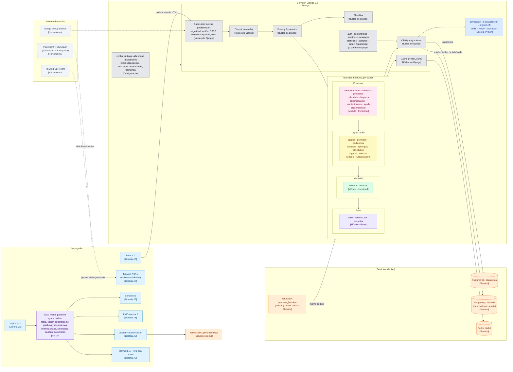

**En pocas palabras.** Es un **monolito modular**: un solo programa de Django dividido en módulos (apps)
ordenados en cuatro capas. El navegador recibe páginas de Django y, con **htmx**, pide trozos de HTML
sin recargar; **Alpine** da los comportamientos pequeños, y las **islas** de JavaScript se usan solo
para el calendario, el kanban, los mapas, los diagramas y poco más. Los datos van a **PostgreSQL**
(dos bases que no se pueden unir: la plataforma y la bóveda) y lo que se calcula mucho (permisos,
audiencias, contadores) se guarda en **Redis**. Un **trabajador** aparte reparte las notificaciones y
hace las tareas de cada día.

## 3. Las capas y la regla de dependencias

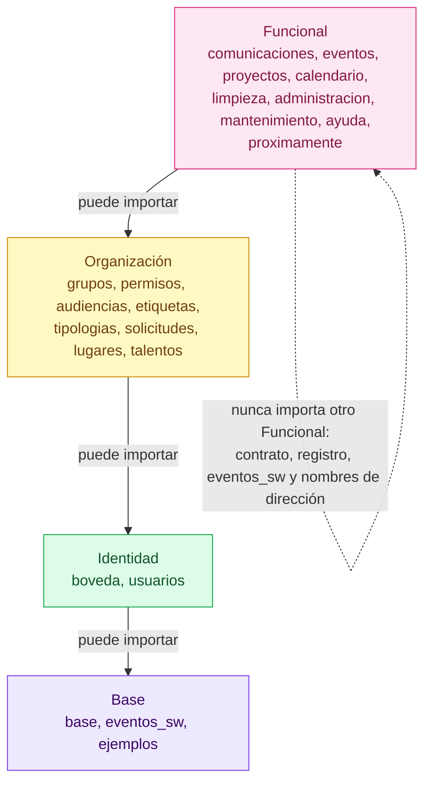

- Un módulo solo importa módulos de **capas inferiores** (o de la suya, si no es Funcional). Lo vigila
  la prueba `base/tests/test_dependencias.py`.
- Dos módulos **funcionales** nunca se importan: se conectan por el **contrato** (cada módulo declara lo
  que aporta en su `apps.py`), el **registro** (que lo reúne al arrancar), los **eventos_sw** (avisos
  internos) y los **nombres de dirección** (`reverse("proyectos:tarea")`). Las pruebas de un módulo usan
  `apps.get_model` para los modelos de otro.

## 4. Cómo viaja una petición

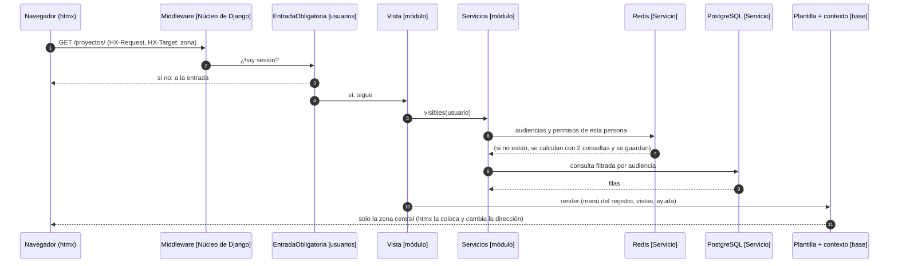

## 5. Cómo se conectan los módulos sin importarse

### 5.1 El contrato y el registro [Componente de base]

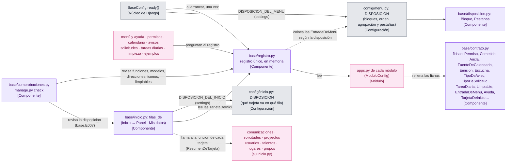

Cada módulo dice en su `apps.py` qué permisos, cometidos, anclas, fuentes del calendario, avisos,
solicitudes, tareas diarias, elementos limpiables, menús y ayudas aporta. Las funciones se nombran como
texto (`"proyectos.limpieza.tareas"`) y el registro las carga con `import_string`. Así `calendario` junta
las fechas de `eventos` y `proyectos` sin importarlos.

El menú es la excepción a «cada módulo lo declara todo»: el módulo declara sus entradas (`EntradaDeMenu`:
nombre, dirección, icono, permiso, vistas), pero **dónde va cada una** (el orden y dentro de qué sección)
lo decide un solo fichero, `config/menu.py`, escrito con dos piezas de `base/disposicion.py`: `Bloque`
(«Lo propio», «Administrar», «Plataforma», cada uno con su título, su color y su banda) y `Pestanas` (una
entrada cuyas subsecciones salen arriba, aunque sean de módulos distintos). El registro rehace el árbol del
menú con esa disposición (`registro.bloques` y `registro.menu`) y avisa si falta una entrada, si sobra o si
se repite.

La portada, **Inicio**, funciona igual: cada módulo declara sus recuadros (`TarjetaDeInicio`: título,
icono y la función que hace su resumen) en su `apps.py`, y su función vive en el `inicio.py` del módulo
(por ejemplo, `solicitudes/inicio.py`). Qué recuadro va en qué pantalla («Panel» o «Mis datos»), en qué
fila y en qué orden lo decide un solo fichero, `config/inicio.py`. `base/inicio.py` los junta: pide a cada
tarjeta su `ResumenDeTarjeta` (apartados con líneas y un botón, o una plantilla propia como el árbol de
grupos) sin importar el módulo.

### 5.2 Los eventos_sw y el trabajador [Módulo · Base]

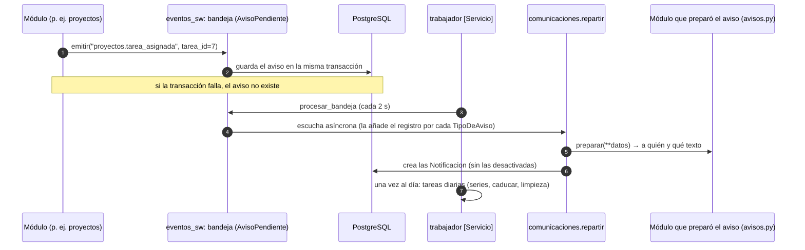

## 6. Módulo a módulo

En cada diagrama, el módulo del que se habla va en el centro y con borde grueso.

### 6.1 base [Módulo · Base]

El cimiento: contrato y registro, plantilla general con los dos menús, componentes comunes y ayudas para
las pruebas, y la portada, «Inicio» (Panel y Mis datos), que junta las tarjetas de los módulos. No depende
de ningún otro módulo nuestro.

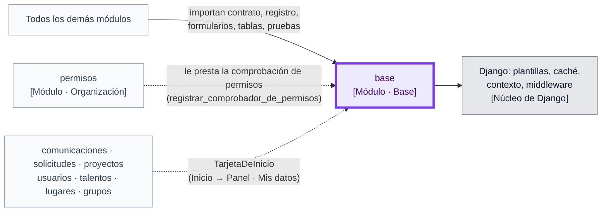

### 6.2 eventos_sw [Módulo · Base]

La bandeja de avisos internos: `emitir()` guarda el aviso en la base de datos dentro de la transacción y
`procesar_bandeja` lo entrega a sus escuchas.

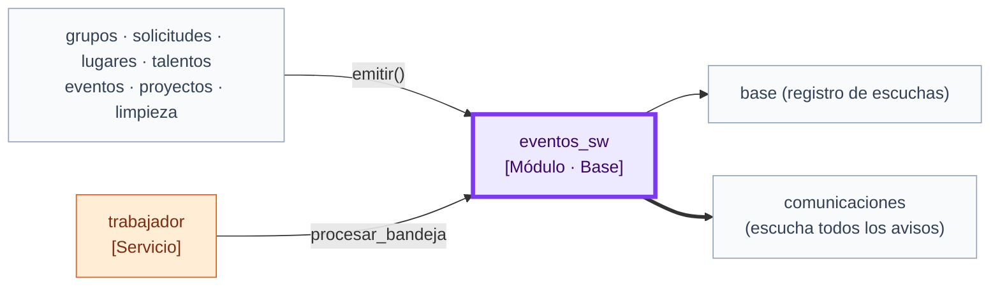

### 6.3 ejemplos [Módulo · Base]

La orden `python manage.py ejemplos crear|borrar` y la pantalla «Pruebas → Datos de ejemplo». Llama, en
orden de capas, a las funciones que cada módulo declara en `datos_de_ejemplo` (al borrar, al revés). El
borrado de cada módulo quita también lo creado al probar en las organizaciones y por las personas de
ejemplo; `eventos` y `calendario` solo borran.

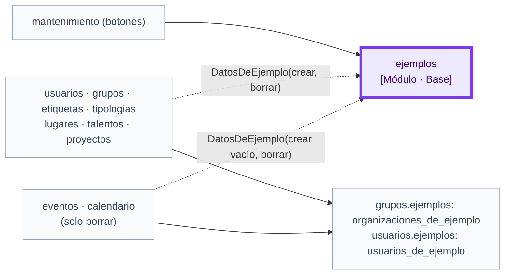

### 6.4 boveda [Módulo · Identidad]

La identidad real (nombre, correo mientras está pendiente, huella), en **su propia base de datos**, sin
ninguna columna que la una a los alias. El enrutador de `config` manda sus tablas allí.

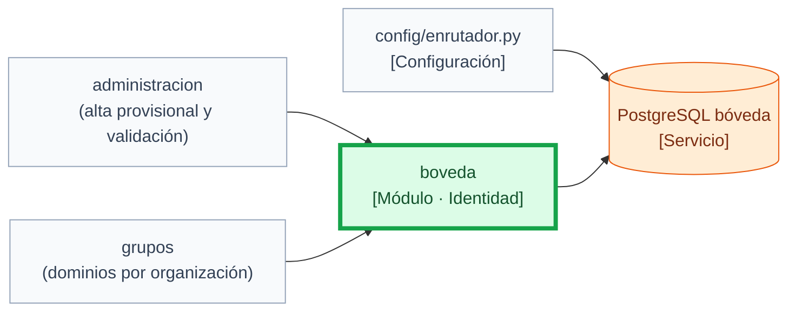

### 6.5 usuarios [Módulo · Identidad]

El usuario de la aplicación (`Usuario`, con alias y sin datos personales), entrar y salir, «Configuración de mi cuenta» y
la capa intermedia `EntradaObligatoria` (nada se ve sin sesión). Contraseñas con Argon2.

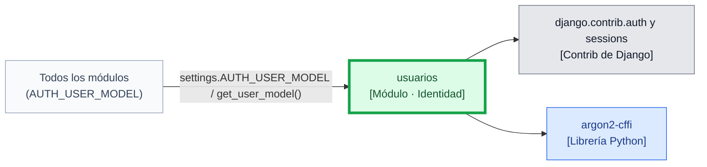

### 6.6 grupos [Módulo · Organización]

Organizaciones y grupos a cualquier profundidad (tabla de cierre `Contencion`), pertenencias, asamblea
base, admins, relaciones e invitaciones entre organizaciones. La solicitud «Entrar en un grupo». El
componente de **árboles de grupos** (`grupos/arboles.py` y la plantilla `grupos/arboles.html`): los grupos
de cada persona en árbol, con su asamblea base en amarillo y el grupo que se mira en rojo.

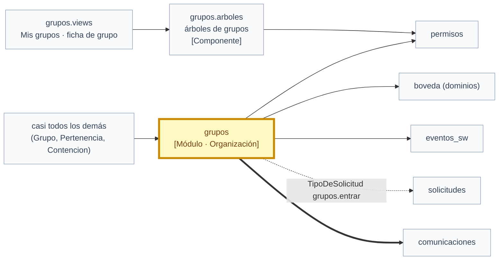

### 6.7 permisos [Módulo · Organización]

Roles del sistema y personalizados, permisos declarados en los contratos, excepciones, cometidos, la
caché de lo que puede cada persona y `puede`, `exigir`, `@requiere_permiso` y la pantalla 403 que explica.

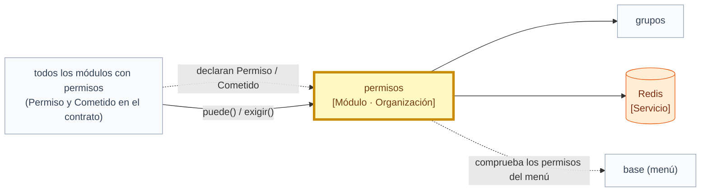

### 6.8 audiencias [Módulo · Organización]

Quién ve cada cosa: privada, grupos con subgrupos, organización o pública (y lo personal, que no ve ni el
superadmin). El selector de visibilidad y la regla dura entre organizaciones. Lo que ve cada persona se
calcula con 2 consultas y se guarda en Redis. `audiencias/cercania.py` da las personas que ven algo,
ordenadas por cercanía al grupo de referencia, para el selector de personas (y quién puede ver esa lista).

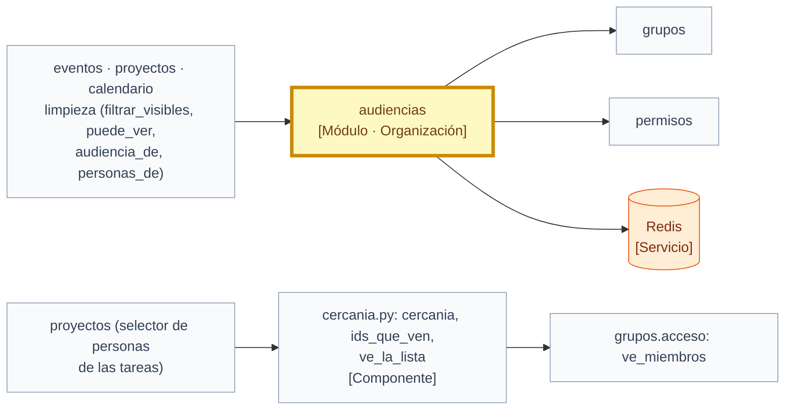

### 6.9 etiquetas [Módulo · Organización]

Etiquetas de cada organización y comunes, con palabras relacionadas. `CampoDeEtiquetas` para los
formularios y `etiquetar()` para cualquier cosa con un ancla.

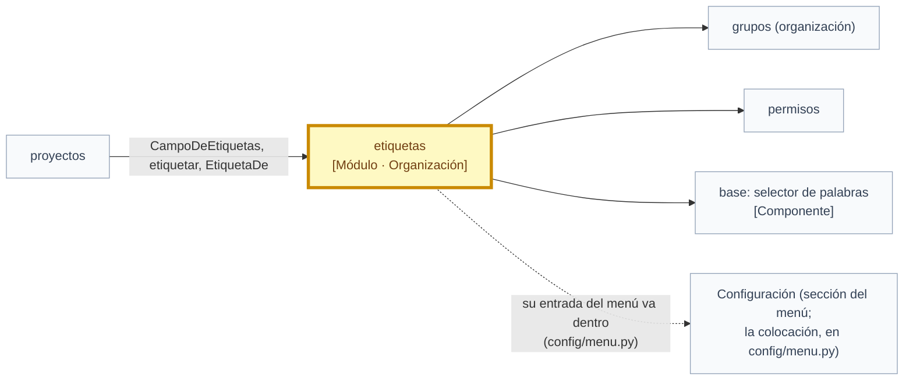

### 6.10 tipologias [Módulo · Organización]

Árbol de tipos de evento y de proyecto (comunes y de cada organización), con campos personalizados que
se heredan y, en los de proyecto, **tareas modelo**. También es dueño de la sección «Configuración».

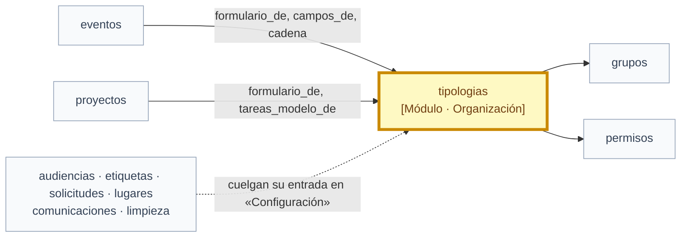

### 6.11 solicitudes [Módulo · Organización]

Lo que se pide con apoyos (y el sí de la administración): cada módulo declara sus tipos; `solicitudes`
lleva apoyos, plazo y estado, y llama a la función del módulo al aceptarse.

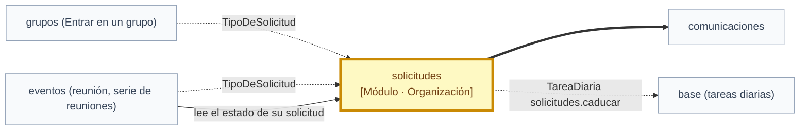

### 6.12 lugares [Módulo · Organización]

Lista común de lugares con mapa, el lugar privado de cada persona, propuestas e importación.

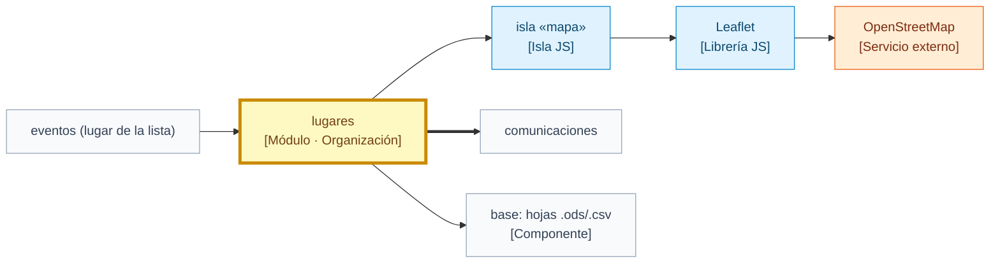

### 6.13 talentos [Módulo · Organización]

Catálogo de recursos y habilidades, lo que cada persona comparte con sus grupos (solo se ven números) y
las peticiones de talentos.

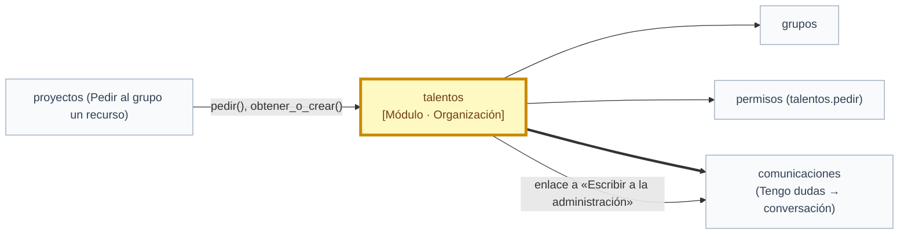

### 6.14 comunicaciones [Módulo · Funcional]

Notificaciones en la web (reparte los avisos de todos), avisos y conversaciones con la administración,
niveles de aviso y preferencias. Borra sus notificaciones viejas cuando se lo pide `limpieza`.

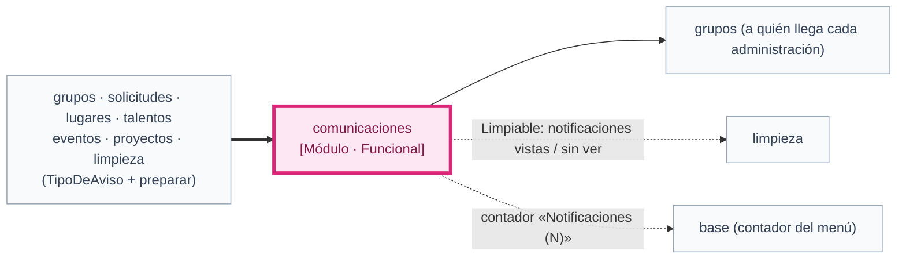

### 6.15 eventos [Módulo · Funcional]

Convocar con visibilidad y tipología, reuniones con apoyos, «¿Vas a ir?», cometidos, cartel, series y su
paso por el calendario y la limpieza.

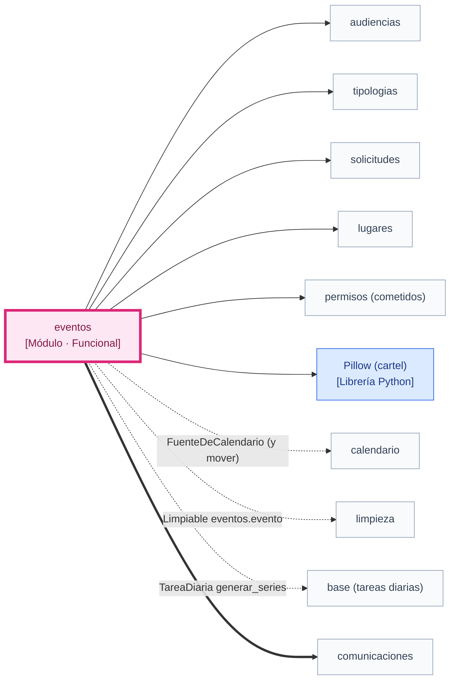

### 6.16 calendario [Módulo · Funcional]

El calendario común (isla de FullCalendar) con las fuentes de todos los módulos, recordatorios y la
suscripción .ics con clave secreta.

```mermaid
flowchart LR
  classDef yo fill:#fce7f3,stroke:#db2777,stroke-width:4px,color:#831843
  classDef otro fill:#f8fafc,stroke:#94a3b8,color:#334155
  classDef libjs fill:#e0f2fe,stroke:#0284c7,color:#0c4a6e
  cal["calendario<br/>[Módulo · Funcional]"]:::yo
  fuentes["eventos · proyectos<br/>(FuenteDeCalendario)"]:::otro
  aud["audiencias"]:::otro
  isla["isla «calendario»<br/>[Isla JS]"]:::libjs
  fc["FullCalendar 6<br/>[Librería JS]"]:::libjs
  ics["Programas de calendario<br/>(.ics sin sesión)"]:::otro
  lim["limpieza"]:::otro
  fuentes -. "fechas() y mover()" .-> cal
  cal --> aud
  isla -- "/calendario/datos/ y /mover/" --> cal
  isla --> fc
  ics -- "/calendario/ics/clave.ics" --> cal
  cal -. "Limpiable recordatorio" .-> lim
```

### 6.17 proyectos [Módulo · Funcional]

Proyectos de grupo y personales con subproyectos a cualquier profundidad, cometidos, tareas (en proyecto,
sueltas o personales) con dependencias que bloquean solas, kanban, recursos, etiquetas y tareas modelo. El
componente de **árboles de proyectos** (`proyectos/arboles.py`): un árbol por proyecto principal, con sus
tareas plegadas, los proyectos en los que participas en amarillo y el que miras en rojo. Su tarjeta de
Inicio, «Mis proyectos abiertos» (`proyectos/inicio.py`).

```mermaid
flowchart LR
  classDef yo fill:#fce7f3,stroke:#db2777,stroke-width:4px,color:#831843
  classDef otro fill:#f8fafc,stroke:#94a3b8,color:#334155
  classDef libjs fill:#e0f2fe,stroke:#0284c7,color:#0c4a6e
  pro["proyectos<br/>[Módulo · Funcional]"]:::yo
  aud["audiencias"]:::otro
  per["permisos (cometidos, proyectos.crear)"]:::otro
  tip["tipologias (campos y tareas modelo)"]:::otro
  eti["etiquetas"]:::otro
  tal["talentos (peticiones)"]:::otro
  kan["isla «kanban»<br/>[Isla JS]"]:::libjs
  sor["SortableJS<br/>[Librería JS]"]:::libjs
  selp["isla «selectorDePersonas»<br/>[Isla JS]"]:::libjs
  cerca["audiencias.cercania"]:::otro
  bas["base: CampoDePersonas"]:::otro
  cal["calendario"]:::otro
  lim["limpieza"]:::otro
  com["comunicaciones"]:::otro
  pro --> aud
  pro --> per
  pro --> tip
  pro --> eti
  pro --> tal
  kan -- "/proyectos/tareas/mover/" --> pro
  kan --> sor
  pro --> cerca
  pro --> bas
  selp -- "/proyectos/tareas/personas/ (JSON)" --> pro
  pro -. "FuenteDeCalendario proyectos y tareas" .-> cal
  pro -. "Limpiable proyecto y tarea" .-> lim
  pro ==> com
  arbp["proyectos.arboles<br/>árboles de proyectos<br/>[Componente]"]:::otro
  arbp --> per
  pro --> arbp
  ini["base: Inicio"]:::otro
  pro -. "TarjetaDeInicio proyectos.abiertos" .-> ini
```

### 6.18 limpieza [Módulo · Funcional]

Cada día archiva lo terminado, avisa antes de borrar, deja conservar y borra con registro. No conoce a
nadie: los tipos limpiables los declaran los demás.

```mermaid
flowchart LR
  classDef yo fill:#fce7f3,stroke:#db2777,stroke-width:4px,color:#831843
  classDef otro fill:#f8fafc,stroke:#94a3b8,color:#334155
  lim["limpieza<br/>[Módulo · Funcional]"]:::yo
  decl["proyectos · eventos · calendario<br/>(Limpiable: terminados, ficha)"]:::otro
  com1["comunicaciones<br/>(Limpiable: borrar)"]:::otro
  aud["audiencias (quién lo ve)"]:::otro
  base["base (tarea diaria limpieza.limpiar)"]:::otro
  com["comunicaciones (avisos)"]:::otro
  decl -. "qué está terminado" .-> lim
  com1 -. "borrar notificaciones viejas" .-> lim
  lim --> aud
  lim -. "TareaDiaria" .-> base
  lim ==> com
```

### 6.19 administracion [Módulo · Funcional]

La sección «Usuarios» del superadmin: bóveda (personas, dominios), alias y roles y permisos. Además declara
las secciones que juntan pantallas de varios módulos en «Administrar» (Grupos que administro, Buzón de la
administración, Eventos y talentos, Mi organización) y en «Plataforma» (Catálogos comunes): solo nombran
direcciones de otros módulos, no los importan.

```mermaid
flowchart LR
  classDef yo fill:#fce7f3,stroke:#db2777,stroke-width:4px,color:#831843
  classDef otro fill:#f8fafc,stroke:#94a3b8,color:#334155
  adm["administracion<br/>[Módulo · Funcional]"]:::yo
  bov["boveda"]:::otro
  gru["grupos"]:::otro
  per["permisos (roles, excepciones, explicar)"]:::otro
  otros["grupos · comunicaciones · talentos · lugares<br/>audiencias · tipologias · etiquetas · proximamente<br/>(sus entradas, como pestañas)"]:::otro
  adm --> bov
  adm --> gru
  adm --> per
  otros -. "colocadas en sus secciones<br/>(config/menu.py)" .-> adm
```

### 6.20 mantenimiento [Módulo · Funcional]

«Desarrollo y mantenimiento» (solo el superadmin): pruebas (importaciones y datos de ejemplo) y la
entrada a la trastienda. La documentación pasó al módulo `ayuda` (14 de noviembre de 2026).

```mermaid
flowchart LR
  classDef yo fill:#fce7f3,stroke:#db2777,stroke-width:4px,color:#831843
  classDef otro fill:#f8fafc,stroke:#94a3b8,color:#334155
  man["mantenimiento<br/>[Módulo · Funcional]"]:::yo
  ej["ejemplos"]:::otro
  hojas["base: hojas .ods/.csv"]:::otro
  gru["grupos y usuarios (importar)"]:::otro
  perm["permisos: requiere_permiso"]:::otro
  man --> ej
  man --> hojas
  man --> gru
  man --> perm
```

### 6.21 ayuda [Módulo · Funcional]

La sección «Ayuda»: «How to?» (para todo el mundo), «Documentación de la plataforma» y «Guía de
desarrollo» (en desarrollo, todo el mundo; en producción, quien tiene `ayuda.ver_documentacion`). Cada
documento de `docs/` es una pestaña; la lista está en `ayuda/documentos.py`. Su entrada del menú lleva
`panel_de_ayuda`: el botón «?» rojo de la cabecera ofrece sus subsecciones y las abre en el panel de la
derecha.

```mermaid
flowchart LR
  classDef yo fill:#fce7f3,stroke:#db2777,stroke-width:4px,color:#831843
  classDef otro fill:#f8fafc,stroke:#94a3b8,color:#334155
  classDef libpy fill:#dbeafe,stroke:#2563eb,color:#1e3a8a
  classDef libjs fill:#e0f2fe,stroke:#0284c7,color:#0c4a6e
  ayu["ayuda<br/>[Módulo · Funcional]"]:::yo
  md["Markdown<br/>[Librería Python]"]:::libpy
  docs["docs/*.md"]:::otro
  base["base: contrato, registro<br/>(puede_ver_entrada), panel.html"]:::otro
  perm["permisos: SinPermiso,<br/>explicar_falta"]:::otro
  isla["islas «documento» e «indice»<br/>[Isla JS]"]:::libjs
  panel["isla «panelDeAyuda»<br/>[Isla JS]"]:::libjs
  mer["Mermaid + svg-pan-zoom<br/>[Librería JS]"]:::libjs
  ayu --> md --> docs
  ayu --> base
  ayu --> perm
  ayu --> isla --> mer
  ayu -. "panel_de_ayuda en su EntradaDeMenu" .-> panel
```

### 6.22 proximamente [Módulo · Funcional]

Las herramientas que aún no existen, cada una con su entrada de menú (para ir organizándolo) y una página
que dice que está vacía y qué hará. Cuando se construye una, su módulo declara su entrada y se cambia su
código en `config/menu.py`.

```mermaid
flowchart LR
  classDef yo fill:#fce7f3,stroke:#db2777,stroke-width:4px,color:#831843
  classDef otro fill:#f8fafc,stroke:#94a3b8,color:#334155
  pro["proximamente<br/>[Módulo · Funcional]"]:::yo
  base["base: contrato, registro<br/>(puede_ver_entrada), proximamente.html"]:::otro
  per["permisos: SinPermiso, explicar_falta"]:::otro
  menu["config/menu.py<br/>[Configuración]"]:::otro
  pro --> base
  pro --> per
  menu -. "coloca sus entradas" .-> pro
```

### 6.23 config [Configuración]

Los ajustes (`settings.py`: apps, bases de datos, caché, cookies, guías de desarrollo), las direcciones
(`urls.py`), la disposición del menú (`menu.py`: el orden y la agrupación de todas las entradas), el
enrutador que separa la bóveda y la trastienda (el admin de Django con nuestro aspecto).

```mermaid
flowchart LR
  classDef yo fill:#e5e7eb,stroke:#374151,stroke-width:4px,color:#111827
  classDef otro fill:#f8fafc,stroke:#94a3b8,color:#334155
  classDef servicio fill:#ffedd5,stroke:#ea580c,color:#7c2d12
  conf["config<br/>[Configuración]"]:::yo
  env["variables de entorno<br/>(docker-compose)"]:::otro
  reg["base: registro<br/>(lee la disposición del menú)"]:::otro
  urls["urls de cada módulo"]:::otro
  pg[("PostgreSQL x2<br/>[Servicio]")]:::servicio
  redis[("Redis<br/>[Servicio]")]:::servicio
  env --> conf
  conf --> urls
  conf --> pg
  conf --> redis
  reg -- "config/menu.py" --> conf
```

## 7. Componente a componente

### 7.1 Plantilla general, menú y ayuda [Componente de base]

```mermaid
flowchart LR
  classDef comp fill:#ede9fe,stroke:#7c3aed,color:#3b0764
  classDef otro fill:#f8fafc,stroke:#94a3b8,color:#334155
  pagina["pagina.html (menú por bloques) / zona.html<br/>(pestañas en dos filas, banda) / panel.html<br/>[Componente]"]:::comp
  contexto["contexto.py: interfaz()<br/>menú, vistas, ayuda, título,<br/>ayuda lateral, plantilla (zona o panel)<br/>[Componente]"]:::comp
  registro["registro: menú (ya colocado),<br/>rutas, ayuda, entrada_de_ayuda"]:::otro
  disposicion["config/menu.py<br/>[Configuración]"]:::otro
  panelAyuda["isla «panelDeAyuda»<br/>(abrir, arrastrar, letra − +, recordar)<br/>[Isla JS]"]:::comp
  miniayuda["zona.html: miniayuda «?»<br/>(ventana emergente con texto y ejemplo)<br/>[Componente]"]:::comp
  paginasAyuda["páginas de la ayuda<br/>(módulo ayuda)"]:::otro
  permisos["permisos: qué entradas se ven<br/>(o tambien_si)"]:::otro
  contadores["contadores de los módulos<br/>(en caché)"]:::otro
  menuLateral["isla «menuLateral»<br/>(plegar, recordar)<br/>[Isla JS]"]:::comp
  htmx["htmx: solo la zona central"]:::otro
  contexto --> registro
  contexto --> permisos
  contexto --> contadores
  pagina --> contexto
  pagina --> menuLateral
  pagina --> panelAyuda
  panelAyuda -- "htmx.ajax al panel<br/>(HX-Target: panel-de-ayuda-contenido)" --> paginasAyuda
  pagina --> miniayuda
  miniayuda -. "Ayuda del contrato<br/>(registro.ayuda)" .-> registro
  registro --> disposicion
  htmx --> pagina
```

El panel de ayuda está fuera de `#zona`: navegar con el menú solo cambia la zona central, así que el
panel no se vuelve a pintar. Lo que se abre en él se pide con htmx y el servidor lo pinta con
`base/panel.html` en lugar de `zona.html` (lo decide `contexto.py` por la cabecera `HX-Target`).

### 7.2 Tabla filtrable, botón «copiar» y selectores de palabras y de personas [Componente de base]

```mermaid
flowchart LR
  classDef comp fill:#ede9fe,stroke:#7c3aed,color:#3b0764
  classDef otro fill:#f8fafc,stroke:#94a3b8,color:#334155
  tablas["tablas.py + tabla.html<br/>[Componente]"]:::comp
  tablaLocal["isla «tablaLocal»<br/>(filtro sin recargar)<br/>[Isla JS]"]:::comp
  copiar["isla «copiar»<br/>[Isla JS]"]:::comp
  selector["SelectorDePalabras + CampoDePalabras<br/>+ isla «selectorDePalabras»<br/>[Componente]"]:::comp
  personas["SelectorDePersonas + CampoDePersonas<br/>+ isla «selectorDePersonas»<br/>[Componente]"]:::comp
  usan4["proyectos (responsable y colaboran)<br/>con la lista de audiencias.cercania"]:::otro
  usan1["administracion · grupos · lugares"]:::otro
  usan2["calendario (suscripción) · …"]:::otro
  usan3["etiquetas (CampoDeEtiquetas) → proyectos"]:::otro
  tablas --> tablaLocal
  usan1 --> tablas
  usan2 --> copiar
  usan3 --> selector
  usan4 --> personas
```

### 7.3 Islas de JavaScript [Isla JS]

Todas viven en `base/static/base/interfaz.js`; las librerías grandes se cargan solo cuando una isla las
necesita (`cargarUnaVez`).

```mermaid
flowchart LR
  classDef isla fill:#ede9fe,stroke:#7c3aed,color:#3b0764
  classDef libjs fill:#e0f2fe,stroke:#0284c7,color:#0c4a6e
  classDef otro fill:#f8fafc,stroke:#94a3b8,color:#334155
  alp["Alpine.js<br/>[Librería JS]"]:::libjs
  ordenable["listaOrdenable<br/>(campos de tipologías)"]:::isla
  kanban["kanban<br/>(tareas)"]:::isla
  mapa["mapa<br/>(lugares)"]:::isla
  calendario["calendario"]:::isla
  documento["documento<br/>(ayuda: casillas y diagramas)"]:::isla
  indice["indice<br/>(plegar el índice)"]:::isla
  panelAyuda["panelDeAyuda<br/>(panel de la derecha)"]:::isla
  htmxlib["htmx"]:::libjs
  sortable["SortableJS"]:::libjs
  leaflet["Leaflet"]:::libjs
  fc["FullCalendar"]:::libjs
  mer["Mermaid + svg-pan-zoom"]:::libjs
  srv["Servidor: /configuracion/tipologias/ordenar/ · /proyectos/tareas/mover/<br/>/calendario/datos/ · /calendario/mover/"]:::otro
  alp --> ordenable & kanban & mapa & calendario & documento & indice & panelAyuda
  panelAyuda --> htmxlib
  ordenable --> sortable
  kanban --> sortable
  mapa --> leaflet
  calendario --> fc
  documento --> mer
  ordenable & kanban & calendario --> srv
```

### 7.4 Tareas diarias [Componente de base]

```mermaid
flowchart LR
  classDef comp fill:#ede9fe,stroke:#7c3aed,color:#3b0764
  classDef otro fill:#f8fafc,stroke:#94a3b8,color:#334155
  classDef servicio fill:#ffedd5,stroke:#ea580c,color:#7c2d12
  trab["trabajador: procesar_bandeja<br/>[Servicio]"]:::servicio
  tareas["base/tareas.py<br/>ejecutar_las_de_hoy()<br/>[Componente]"]:::comp
  redis[("Redis: «ya se hizo hoy»")]:::servicio
  orden["manage.py tareas_diarias<br/>(a mano)"]:::otro
  t1["eventos.generar_series"]:::otro
  t2["solicitudes.caducar"]:::otro
  t3["limpieza.limpiar"]:::otro
  trab -- "cada vuelta" --> tareas
  tareas -- "cache.add" --> redis
  orden --> tareas
  tareas -.-> t1 & t2 & t3
```

### 7.5 Pruebas [Componente de base]

```mermaid
flowchart LR
  classDef comp fill:#ede9fe,stroke:#7c3aed,color:#3b0764
  classDef herramienta fill:#f1f5f9,stroke:#94a3b8,color:#334155,stroke-dasharray:4 3
  classDef otro fill:#f8fafc,stroke:#94a3b8,color:#334155
  pdp["PruebaDePantalla<br/>comprobar_consultas (≤15, no crece)<br/>[Componente]"]:::comp
  pen["PruebaEnElNavegador<br/>(errores de JavaScript)<br/>[Componente]"]:::comp
  pw["Playwright + Chromium<br/>[Herramienta]"]:::herramienta
  dep["test_dependencias<br/>(regla de capas)"]:::comp
  mods["tests/ de cada módulo"]:::otro
  mods --> pdp
  mods --> pen --> pw
  dep -- "lee el código de todos" --> mods
```

### 7.6 Hojas de cálculo [Componente de base]

`base/hojas.py` escribe y lee .ods (LibreOffice) y lee .csv sin librerías externas. Lo usan las
importaciones de `mantenimiento` (grupos y usuarios) y de `lugares`.

```mermaid
flowchart LR
  classDef comp fill:#ede9fe,stroke:#7c3aed,color:#3b0764
  classDef otro fill:#f8fafc,stroke:#94a3b8,color:#334155
  hojas["base/hojas.py<br/>[Componente]"]:::comp
  man["mantenimiento: importar grupos y usuarios"]:::otro
  lug["lugares: importar lugares"]:::otro
  man --> hojas
  lug --> hojas
```

## 8. Servicios

| Servicio | Etiqueta | Para qué | Quién lo usa |
|---|---|---|---|
| PostgreSQL (plataforma) | [Servicio] | Todos los datos de la aplicación | ORM de Django, todos los módulos |
| PostgreSQL (bóveda) | [Servicio] | La identidad real, separada | Solo `boveda` (por el enrutador) |
| Redis | [Servicio] | Caché: permisos, audiencias, contadores, «tareas de hoy hechas» | permisos, audiencias, comunicaciones, base |
| trabajador | [Servicio] | Reparte la bandeja de eventos_sw y hace las tareas diarias | eventos_sw, base/tareas.py |
| OpenStreetMap | [Servicio externo] | Teselas del mapa | isla «mapa» (lugares) |
